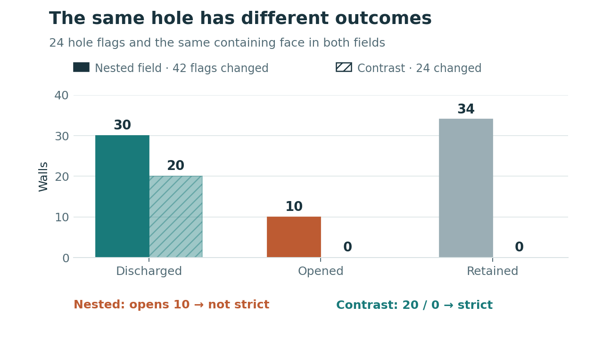
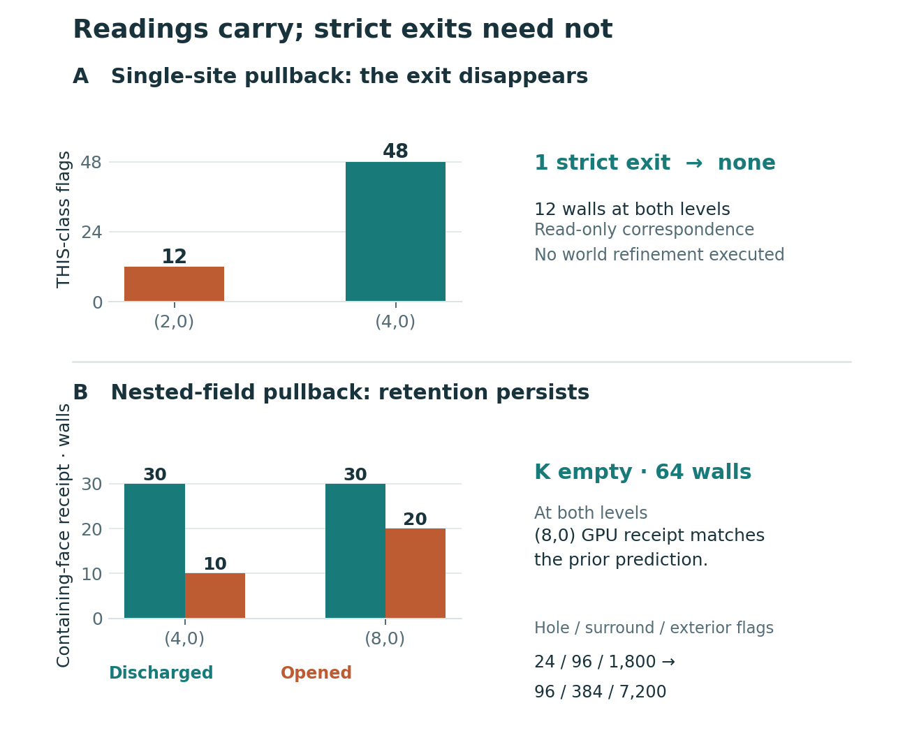
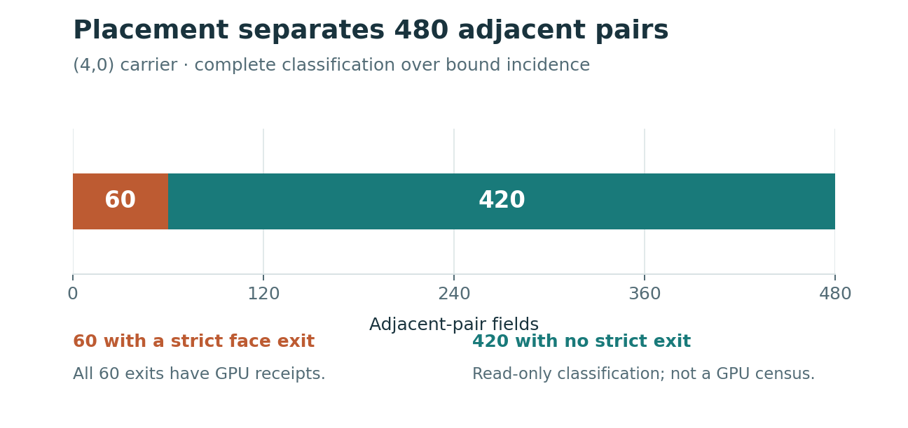

# What Makes a Structure Hold?

*The same region dissolves or persists depending on its surroundings. Refinement can remove its only exit. The receipts show why.*

I kept the hole exactly where it was. Same flags. Same reading. Same ancestry. Then I changed everything around it.

In one field, the hole dissolved. In the other, it held.

That is the central result of my new paper, [*Persistence from Geometry: Context, Refinement and Deterministic Change*](https://doi.org/10.5281/zenodo.23855122). A structure's persistence depends on what an attempted change would do to the rest of its world.

The previous paper showed one region dissolving while adjacent pairs remained bound. This one asks why they hold, what can protect an internal region, and whether refinement itself can create persistence.

The answers are in the receipts.

## The surroundings protect the hole

The field assigns each flag one of two readings, THIS or NO. Overlapping flags either agree or disagree. Every disagreement is a wall.

The rule for strict change is exact: remove at least one wall and open none. Each offered assignment gets a receipt naming what it discharges and what it opens. Removing thirty walls cannot compensate for opening one.

In the decisive configuration, a 24-flag NO hole sits inside a 96-flag THIS region, surrounded by 1,800 NO flags. The complete computation over the bound incidence finds no strict exit.

One offered assignment contains the entire hole. Reading that face THIS would fill it. But the face also contains eighteen flags from the exterior.

The GPU receipt records thirty walls discharged and ten opened. The assignment is excluded BECAUSE filling the hole also cuts the exterior's agreement.

Now keep the hole unchanged and read everything else THIS. The same face assignment discharges twenty walls and opens none. This time it is strict.

The exterior protects the hole through an assignment they share. Protection is witnessed in the ten walls that the attempted filling would open. Both receipts are in the paper's evidence.

*Same hole, different surroundings. Both rows are GPU receipts. The complete nested-field no-exit result is a separate computation over the bound incidence.*

This is held structure inside held structure. The field around the hole is part of what lets it persist.

## Refinement can remove an exit

A second result changes the picture again.

Start with a twelve-flag site region. It has twelve walls and one strict exit: the region reads NO. It can dissolve.

Carry its readings into a finer incidence using the recorded parent-to-child map. Each child inherits its parent's reading. The region now occupies 48 flags, still with twelve walls.

The complete check finds no strict exit.

The exit disappears BECAUSE the recorded ancestral site assignment still covers twelve flags, while the inherited region has spread to 48. The available assignments and the inherited field have changed their relationship.

This result is a read-only correspondence between two bound carriers. It is not a refinement performed on the committed world. It shows exactly how a field that can dissolve at one level can hold at the next.

Refinement can also preserve retention. For the nested field, a derivation made before execution predicted 64 walls, no strict exit, and a containing-face receipt of thirty discharged and twenty opened at the next level.

The RTX 3070 evaluated all 33,256 raw assignments on that transported configuration. Every predicted quantity matched.

One configuration acquires retention. Another carries it through refinement. The paper keeps both results, with their different scopes.

*Two refinement results, two scopes: the single-site comparison is read-only; the nested prediction is checked by GPU execution on one transported field.*

## Placement matters, and context reaches further

At the finer level, the complete incidence computation classifies all 480 adjacent pairs: sixty have a strict face exit; 420 remain held under the recorded assignments. GPU receipts witness every one of those sixty exits.

*Complete classification over bound incidence; targeted GPU receipts for every predicted exit. The 420 retained pairs are not presented as an exhaustive GPU census.*

The shedding pairs fit inside original-face images. The held pairs escape those offers. Placement separates this family BECAUSE it determines whether an offered assignment can take the whole pair without cutting its agreement.

The hole experiment establishes the next distinction. Containing a region is insufficient when the assignment also cuts something else. The whole changed set determines the result.

The paper calls the non-uniform field with no strict exit **SAND**. That is a defined retention relation. A protected region alone does not establish it: one part can remain protected while another part still has a strict exit.

## Several changes, one next snapshot

The experiments also expose fields with several enabled effects. The construction derives their relationship before applying them.

On the closed carriers and whole-site fields studied here, distinct enabled effects commute or are absorbed by another enabled effect. Equivalent offers retain their separate identities while producing one effect.

The joint application uses only the effects enabled in the source snapshot. Anything it newly enables waits for the next proposal BECAUSE the step cannot read its own results before commit.

The GPU diagnostics include two separated singles discharging twenty-two walls together, with none opened. They also reproduce the earlier committed singleton result. Proper absorption remains a derived case; the diagnostics found no distinct positive fixture for it. Full qualification of the combined application remains incomplete, as the paper states.

## Follow the claim to the receipt

The evidence distinguishes exhaustive GPU sweeps of the listed families at two coarser levels, full read-only classification at the finer level, 89 targeted finer-level GPU receipts, and one transported configuration checked against all its offers.

Those distinctions make the result reproducible. The publication includes the paper and companion records under Apache 2.0, with exact file identities and the earlier prediction beside its executed receipt.

We can now say more than “this configuration holds.” We can show what protects it, how changing its surroundings removes that protection, and how carrying its readings into finer geometry can remove its only exit.

Change and persistence come from the same construction. The receipt tells us which relationship the field realizes.

[**Read Paper Two and its companion evidence on Zenodo.**](https://doi.org/10.5281/zenodo.23855122)

[Read Paper One.](https://doi.org/10.5281/zenodo.23673872) · [Follow the repository evidence.](https://github.com/MetaCortex-Dynamics/mal-fabric/tree/main/flag_world_001_first_tick/persistence_paper_publication_v0_1_1_001)
